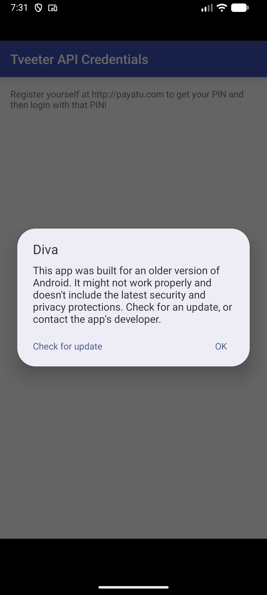
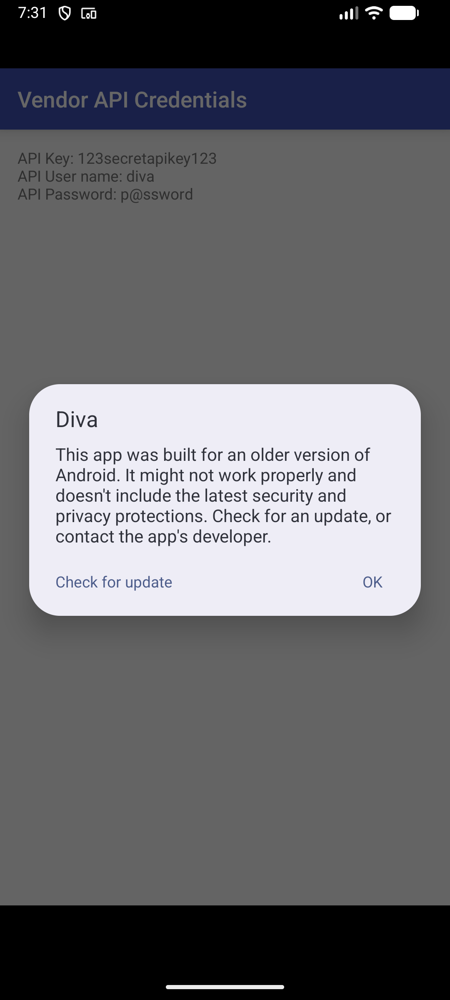
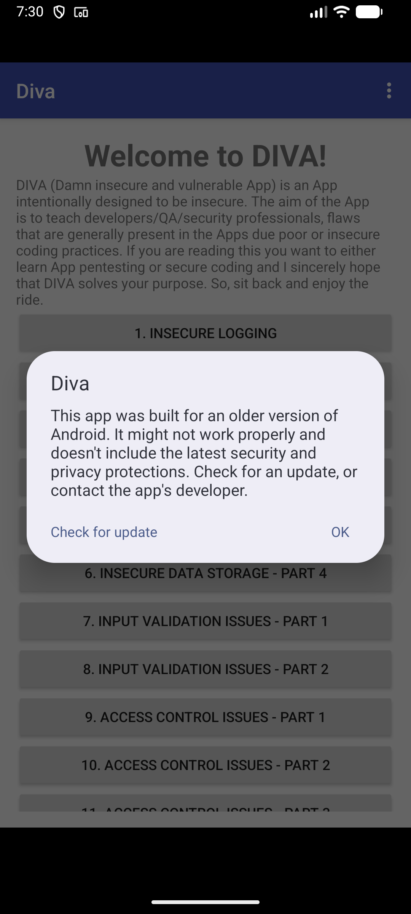

# ProofDroid Report: jakhar.aseem.diva

Generated 2026-11-10T19:30:28+05:30 by ProofDroid 0.1.0.

## Summary

| Status | Count |
| --- | --- |
| Confirmed | 3 |
| Unconfirmed | 1 |
| Not testable | 4 |

## Target

- **Package:** jakhar.aseem.diva
- **Version:** 1.0
- **APK:** diva.apk
- **SHA-256:** `5cefc51fce9bd760b92ab2340477f4dda84b4ae0c5d04a8c9493e4fe34fab7c5`
- **Static analysis:** ProofDroid built-in (aapt2)
- **Dynamic analysis:** enabled
- **Device:** sdk\_gphone64\_arm64, Android 16 (API 36)

## Ranked findings

| # | Status | Severity | Finding | Component |
| --- | --- | --- | --- | --- |
| 1 | Confirmed | Medium | [Activity (jakhar.aseem.diva.APICreds2Activity) is not Protected. \[android:exported=true\]](#finding-1) | jakhar.aseem.diva.APICreds2Activity |
| 2 | Confirmed | Medium | [Activity (jakhar.aseem.diva.APICredsActivity) is not Protected. \[android:exported=true\]](#finding-2) | jakhar.aseem.diva.APICredsActivity |
| 3 | Confirmed | Medium | [Content Provider (jakhar.aseem.diva.NotesProvider) is not Protected. \[android:exported=true\]](#finding-3) | jakhar.aseem.diva.NotesProvider |
| 4 | Unconfirmed | High | [Clear text traffic is Enabled For App \[android:usesCleartextTraffic=true\]](#finding-4) |  |
| 5 | Not testable | High | [Debug Enabled For App \[android:debuggable=true\]](#finding-5) |  |
| 6 | Not testable | Medium | [App can be installed on a vulnerable Android version (minSdk 15)](#finding-6) |  |
| 7 | Not testable | Medium | [Application Data can be Backed up \[android:allowBackup=true\]](#finding-7) |  |
| 8 | Not testable | Medium | [Sensitive data stored insecurely on the device](#finding-8) |  |

## Details

### 1. [Confirmed] Activity (jakhar.aseem.diva.APICreds2Activity) is not Protected. \[android:exported=true\]

- **Severity:** Medium
- **Category:** exported\_activity
- **Component:** `jakhar.aseem.diva.APICreds2Activity`
- **Check:** exported-activity
- **Result:** jakhar.aseem.diva.APICreds2Activity was launched directly by an external, unprivileged caller and reached the foreground, bypassing the app's normal entry flow.

This activity can be reached by any other app on the device.

**Evidence:**

- [command.txt](evidence/exported-activity-apicreds2activity/command.txt)
- [resumed\_activity.txt](evidence/exported-activity-apicreds2activity/resumed_activity.txt)
- [screenshot.png](evidence/exported-activity-apicreds2activity/screenshot.png)
- [logcat.txt](evidence/exported-activity-apicreds2activity/logcat.txt)

---

### 2. [Confirmed] Activity (jakhar.aseem.diva.APICredsActivity) is not Protected. \[android:exported=true\]

- **Severity:** Medium
- **Category:** exported\_activity
- **Component:** `jakhar.aseem.diva.APICredsActivity`
- **Check:** exported-activity
- **Result:** jakhar.aseem.diva.APICredsActivity was launched directly by an external, unprivileged caller and reached the foreground, bypassing the app's normal entry flow.

This activity can be reached by any other app on the device.

**Evidence:**

- [command.txt](evidence/exported-activity-apicredsactivity/command.txt)
- [resumed\_activity.txt](evidence/exported-activity-apicredsactivity/resumed_activity.txt)
- [screenshot.png](evidence/exported-activity-apicredsactivity/screenshot.png)
- [logcat.txt](evidence/exported-activity-apicredsactivity/logcat.txt)

---

### 3. [Confirmed] Content Provider (jakhar.aseem.diva.NotesProvider) is not Protected. \[android:exported=true\]

- **Severity:** Medium
- **Category:** exported\_provider
- **Component:** `jakhar.aseem.diva.NotesProvider`
- **Check:** exported-provider
- **Result:** An unprivileged caller read 6 row(s) of private app data from jakhar.aseem.diva.NotesProvider (see command.txt).

This content provider can be reached by any other app on the device.

**Evidence:**

- [command.txt](evidence/exported-provider-notesprovider/command.txt)
- [screenshot.png](evidence/exported-provider-notesprovider/screenshot.png)
- [logcat.txt](evidence/exported-provider-notesprovider/logcat.txt)

---

### 4. [Unconfirmed] Clear text traffic is Enabled For App \[android:usesCleartextTraffic=true\]

- **Severity:** High
- **Category:** manifest
- **Check:** cleartext-traffic
- **Result:** No port-80 connections observed during launch. Cleartext on other ports or behind login is not covered yet.

Plain HTTP is allowed (targetSdk 23, no network security config).

**Evidence:**

- [command.txt](evidence/manifest-clear-text-traffic/command.txt)
- [proc\_net\_tcp.txt](evidence/manifest-clear-text-traffic/proc_net_tcp.txt)
- [screenshot.png](evidence/manifest-clear-text-traffic/screenshot.png)
- [logcat.txt](evidence/manifest-clear-text-traffic/logcat.txt)

---

### 5. [Not testable] Debug Enabled For App \[android:debuggable=true\]

- **Severity:** High
- **Category:** manifest
- **Result:** No automated verification check exists for this finding yet.

Anyone with adb access can attach a debugger and read private app data via run-as.

---

### 6. [Not testable] App can be installed on a vulnerable Android version (minSdk 15)

- **Severity:** Medium
- **Category:** manifest
- **Result:** No automated verification check exists for this finding yet.

Old Android versions no longer receive security patches.

---

### 7. [Not testable] Application Data can be Backed up \[android:allowBackup=true\]

- **Severity:** Medium
- **Category:** manifest
- **Result:** No automated verification check exists for this finding yet.

App data can be extracted with adb backup by anyone with USB access.

---

### 8. [Not testable] Sensitive data stored insecurely on the device

- **Severity:** Medium
- **Category:** storage
- **Check:** insecure-storage
- **Result:** Root is needed to read the app sandbox (use a google\_apis emulator image); external storage was clean.

Runtime inspection of the app sandbox and shared external storage after launch.

**Evidence:**

- [external\_storage.txt](evidence/storage-sandbox/external_storage.txt)

---

_"Confirmed" means ProofDroid reproduced the issue on an emulator and captured evidence. "Unconfirmed" means a check ran but could not prove it. "Not testable" means no automated check exists yet or the dynamic stage could not run; these still deserve manual review. Only test apps you own or are explicitly authorised to test._
